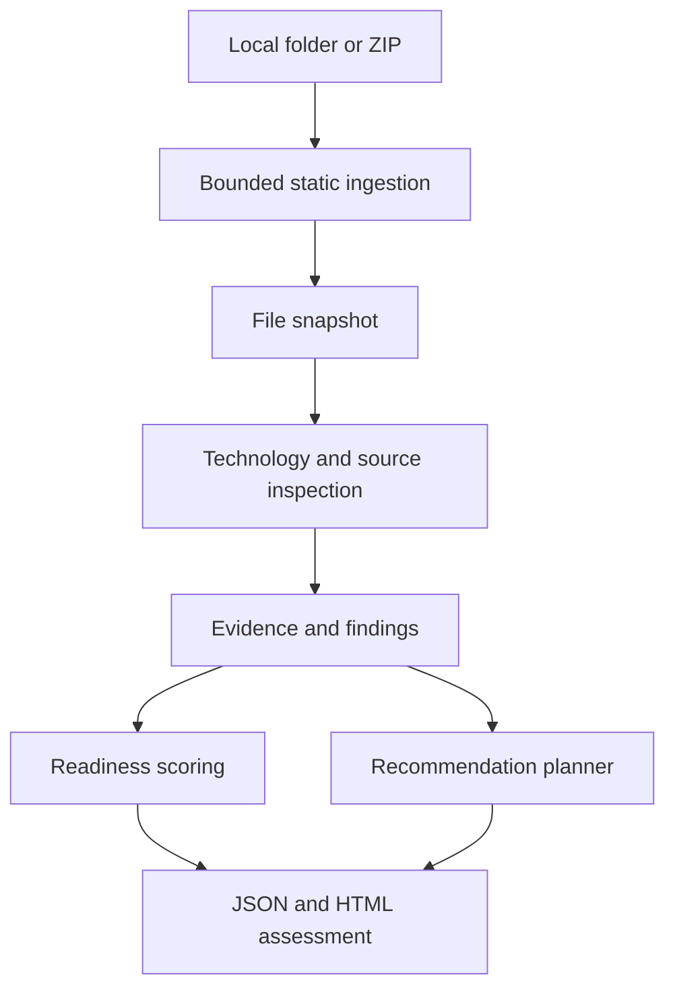

# ModernizeIQ — product specification and architecture

This is the specification for the complete product. The delivered milestone is the deterministic Python assessment and its local report, not the future full-stack platform. Read `README.md` for the implementation boundary.

## 1. Objective

Analyze repository evidence to explain an application's structure, identify selected cloud-readiness barriers, and propose a prioritized modernization plan for human judgment. The product does not migrate applications or prove that they are secure.

## 2. Target users

Application developers preparing a legacy assessment; architects comparing modernization options; consultants explaining technical debt; engineering leads sequencing work. The learning edition is single-user and local.

## 3. Main use cases

Inspect a local folder or ZIP; trace a finding to its source location; inspect dependency declarations; compare a repository before and after a change; explain readiness dimensions; export a technical assessment; propose a phased backlog. Later: portfolio history, reviewer decisions and audit history.

## 4. Functional requirements

Accept bounded static input without execution. Inventory supported text files. Detect Python/Java/JavaScript/TypeScript and selected manifest formats. Find configuration, security and operational indicators. Infer architecture cautiously. Link every finding and recommendation to evidence. Calculate reproducible check-based scores. Emit JSON and a warm graphite/copper HTML report. Keep benchmark truth outside the analyzed application.

Future requirements: SQLite histories, FastAPI resources, React workbench, current/target comparison, review decisions, structured AI explanations and evidence validation. These are requirements, not implemented claims.

## 5. Non-functional requirements

Repeatable results for identical files and scoring configuration; no network calls during scanning; bounded input; redacted evidence; escaped HTML; explicit unsupported cases; no paid service dependency; understandable modules; automated positive, negative and boundary tests. Performance is measured on supplied fixtures, not promised for arbitrary enterprise repositories. Local files must remain unchanged while a scan runs.

## 6. Analysis pipeline

Bounded ingestion → immutable file snapshot → technology and dependency inspection → evidence and findings → architecture hypothesis → documented check scores → evidence-linked recommendations → JSON/HTML export. Evaluation runs separately after assessment; it may read benchmark answers, the analyzer may not.

## 7. Architecture

Later, a FastAPI orchestrator will invoke the same pure analysis functions and persist the output. React will consume versioned DTOs; analysis remains on the server. The future LLM receives selected redacted evidence, returns structured explanations with evidence IDs, and passes a validator before human review. It will not decide underlying findings.

## 8. Security model

Input is untrusted data. No `exec`, dynamic imports, repository installs, shell execution or outbound requests. ZIP members are read in memory, never extracted. Reject unsafe paths, links, duplicates, encrypted members and unsupported compression. Bound compressed size, expanded size, file size, entry count and depth. Skip vendored/build/binary content. Export only fixed descriptions and source locations, never matched secret values or source excerpts. This is a local analysis tool, not a hardened multi-tenant sandbox; hostile public uploads would additionally need isolated workers, OS resource limits, authentication and quotas.

## 9. Database entities (planned)

| Entity | Purpose / key relationship |
|---|---|
| Application, Repository | Portfolio identity; application has repositories |
| AnalysisRun | Repository snapshot hash, analyzer/rule version, status |
| FileInventory, Evidence | Run → path, line, file hash, fixed description |
| Technology, Dependency | Run → observed declarations and detection method |
| Finding | Run → rule, category, severity, evidence references |
| ArchitectureComponent, Relationship | Run → inferred nodes/links and evidence |
| ReadinessScore, ScoreCheck | Run → category totals and auditable contributions |
| Recommendation, RoadmapPhase | Finding-linked action, priority, phase |
| ReviewDecision, AuditEvent | Reviewer, decision, note, timestamp; append-only history |

Start with SQLite foreign keys and explicit migrations when persistence is implemented. Put SQL behind a repository interface so a PostgreSQL adapter can replace storage without rewriting analyzers. Never infer that current JSON files are already a relational database.

## 10. API groups (planned)

`/api/applications`, `/api/analyses`, `/api/technologies`, `/api/dependencies`, `/api/findings`, `/api/security`, `/api/architecture`, `/api/readiness`, `/api/recommendations`, `/api/roadmap`, `/api/reports`, `/api/audit`. Analysis submission will validate size/type, create a run and return a run ID. Use 201/202 for creation/accepted jobs, 404 for absent runs, 409 for invalid transitions and 422 for invalid inputs. No endpoints are served in milestone 1.

## 11. Frontend information architecture (planned)

Portfolio → Assessments → Modernization Workbench. Inside the workbench: identity, current map, readiness, risk register, evidence drawer and roadmap. Dedicated Dependencies, Reports and Audit views. Warm graphite `#12110f`, charcoal `#211f1b`, ivory `#f3efe7`, copper `#d39a45`; no primary blue. Print reports use ivory. Show severity text as well as color and visible keyboard focus. The baseline HTML report previews this design language without pretending to be a React application.

## 12. Scoring philosophy

“This is a configurable modernization-readiness heuristic.” Each dimension is earned check points divided by possible points, multiplied by 100. The overall score is a weighted mean of dimension scores. Every check lists its evidence, points and status. Rules are intentionally small and inspectable. Absence means “not observed within the inspected files,” not proof of runtime absence. Skipped files and parser warnings limit assessment completeness. No invented test coverage, CVE status, migration cost or probability.

## 13. First supported repositories

Primary: small Python applications; requirements.txt and PEP 621/Poetry-style pyproject.toml; Python AST for selected assignments, calls and route decorators. Secondary: package.json dependency declarations and Java/JS/TS file inventory; Maven pom.xml and simple literal Gradle coordinates. Text patterns support properties/env/config and selected Java/JS indicators. Dynamic versions, transitive resolution, full Java/JS parsing and runtime call graphs are unsupported.

## 14. First demo application

`demo-apps/legacy-commerce`: an inert Python commerce sketch with Flask and SQLAlchemy declarations, SQLite configuration, a reserved `.invalid` endpoint, an obviously fake fixture password, local report storage, debug configuration and minimal tests. No install/run step is needed. A second improved-control fixture demonstrates observable testing, environment config, Docker, CI and logging indicators. The analyzer never executes either. Ground truth lives in `benchmarks/`, outside both repositories.

## 15. Learning objectives

Explain trust boundaries; parse structured data; distinguish syntax from execution; trace evidence; understand heuristics and false positives; calculate scores by hand; test adversarial inputs; compare controlled changes; connect a technical risk to an operational consequence. Later learn relational modeling, REST contracts, typed UI state and reviewed AI output.

## 16. Roadmap and acceptance gates

| Stage | Gate |
|---|---|
| Specification and baseline (this delivery) | Safe local/ZIP scan, supported manifests, indicators, evidence, scoring, reports, tests and benchmark |
| Persistence and API | Migration tests, contract tests, run history and structured failures |
| React workbench | Connected evidence inspection, filters, accessible navigation, no dummy controls |
| Planning and review | Current/target distinction, evidence-dependent plan, persisted decisions/audit |
| Optional AI | Structured evidence-only explanations, unsupported-claim rejection, no required paid service |
| Packaging and delivery | Docker builds, meaningful CI, documented limits, recruiter demo and verified screenshots |

These gates group the prompt's phases 0–20. Do not list unimplemented technologies as completed work on a résumé.
